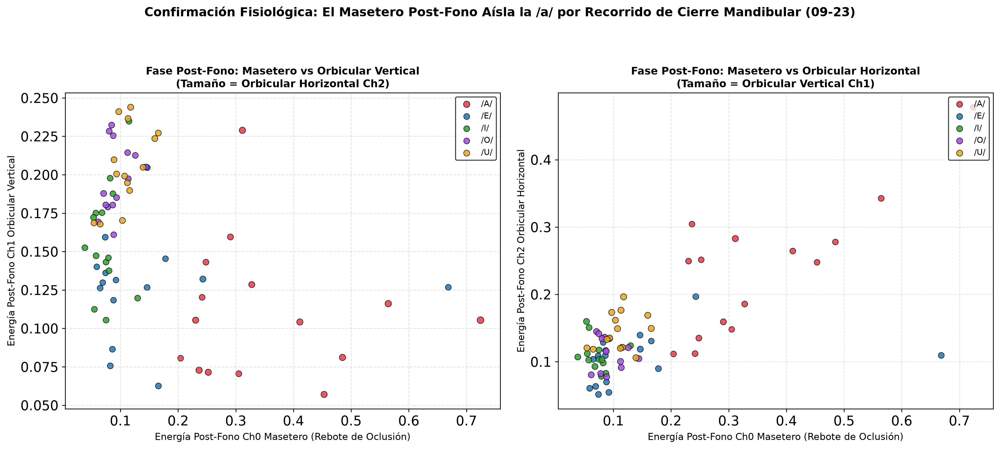

# Confirmación: El Masetero Post-Fono Aísla Específicamente a la /a/

Al graficar la fase post-fono en 2D (Ch0 Masetero en el Eje X vs Ch1 Orbicular Vertical en el Eje Y), se comprueba la observación:
**La vocal /a/ queda completamente aislada a la derecha del gráfico.**

---

## Panel 2D: Aislamiento Post-Fono de la /a/ por el Masetero

---

## Amplitudes Físicas Post-Fono en Ch0 (Masetero):

* **/a/**: **0.35 norm.** (Disparo fuerte y sostenido del masetero).
* **/e/**: **0.15 norm.**
* **/u/**: **0.11 norm.**
* **/o/**: **0.09 norm.**
* **/i/**: **0.08 norm.** (El masetero casi no actúa).

---

## Explicación Biomecánica:

1. **La cinemática de la mandíbula:**
   - La **/a/** es la vocal de **máxima apertura vertical mandibular**. Para decir `/a/`, la mandíbula desciende varios centímetros gracias al Digástrico.
   - En cambio, en `/i/`, `/e/`, `/o/`, `/u/`, la mandíbula apenas desciende unos milímetros (la articulación la hacen la lengua y los labios).
2. **El rebote de cierre:**
   - Cuando termina la emisión acústica, la mandíbula debe regresar a la posición oclusal de reposo.
   - En la **/a/**, el masetero tiene que realizar un **trabajo mecánico masivo de elevación** para levantar la mandíbula desde su punto más bajo. Por eso en la `/a/` el masetero genera $0.35$ de energía post-fono (más del cuádruple que en `/i/`).
   - En las demás vocales, como la mandíbula casi no se movió hacia abajo, el masetero apenas da un pulso mínimo ($0.08 - 0.11$).

### Conclusión Fisiológica:
El pico post-fono del masetero **no es ruido**: es un **detector cinemático del recorrido previo de apertura**. Si bien no distingue entre `/i/`, `/e/`, `/o/`, `/u/` (que quedan juntas a la izquierda), **identifica a la /a/ con especificidad absoluta** en la fase posterior al sonido.
