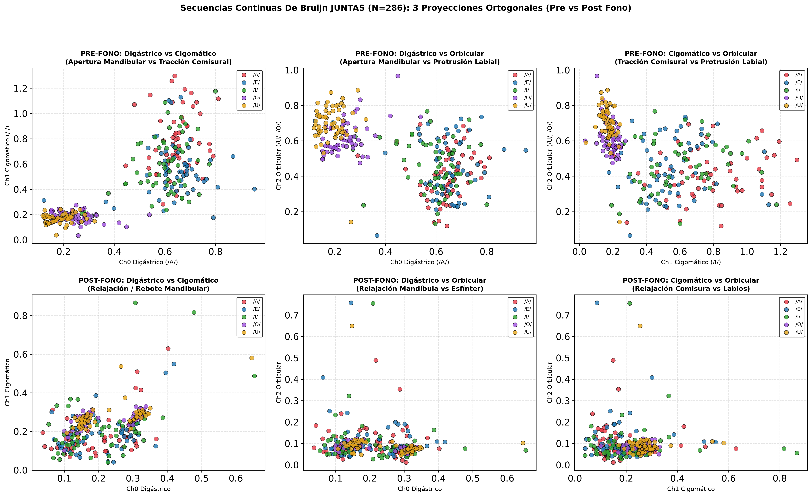

# Secuencias Continuas De Bruijn JUNTAS (N=286): 3 Proyecciones Ortogonales 2D

Comparativa de las tres vistas ortogonales 2D entre la fase **PRE-FONO** (arriba) y la fase **POST-FONO** (abajo):
1. **Digástrico vs Cigomático** (Apertura Mandibular vs Elevación Comisural).
2. **Digástrico vs Orbicular** (Apertura Mandibular vs Protrusión Labial).
3. **Cigomático vs Orbicular** (Elevación Comisural vs Protrusión Labial).

---

## Panel de las 3 Proyecciones Ortogonales (Pre vs Post Fono)

---

## Análisis Biomecánico Plano por Plano:

### 1. Fila Superior: PRE-FONO (Estructura Motora Diferenciada)
* **Plano Digástrico vs Cigomático (Superior Izquierda):**
  - La **/a/** (rojo) se proyecta hacia la derecha por descenso activo de la mandíbula.
  - La **/i/** (verde) se proyecta verticalmente por contracción del cigomático mayor.
  - Ambas ramas son ortogonales, con la **/e/** (azul) situándose en la zona intermedia de coactivación.
* **Plano Digástrico vs Orbicular (Superior Centro):**
  - **/u/** (amarillo) y **/o/** (morado) se disparan hacia arriba a lo largo del eje del Orbicular con mínima apertura del Digástrico.
  - La **/a/** se queda abajo contra el eje horizontal. La separación entre vocales abiertas y redondeadas es total.
* **Plano Cigomático vs Orbicular (Superior Derecha):**
  - Muestra la independencia entre la sonrisa horizontal/diagonal (`/i/`) y el redondeo labial (`/u/`, `/o/`), formando una 'L' limpia que rodea al origen.

---

### 2. Fila Inferior: POST-FONO (Colapso y Pérdida de Ortogonalidad)
* En los tres planos inferiores se observa el mismo fenómeno: **todas las vocales se apelmazan en una masa concentrada en el origen**.
* La **/a/** pierde su brazo extendido en el Digástrico porque la mandíbula ya está en proceso de cierre.
* **/u/** y **/o/** pierden su elevación en el Orbicular porque el esfínter oral se relaja anticipando el próximo fonema de la secuencia continua.
* Ningún plano 2D post-fono ofrece fronteras separables, confirmando que la información fonética en habla continua reside exclusivamente en la ventana preparatoria Pre-Fono.
